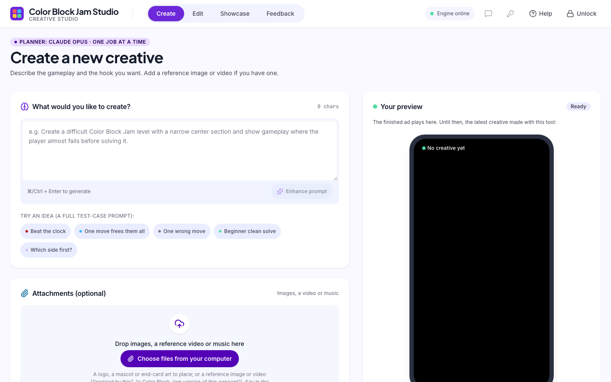
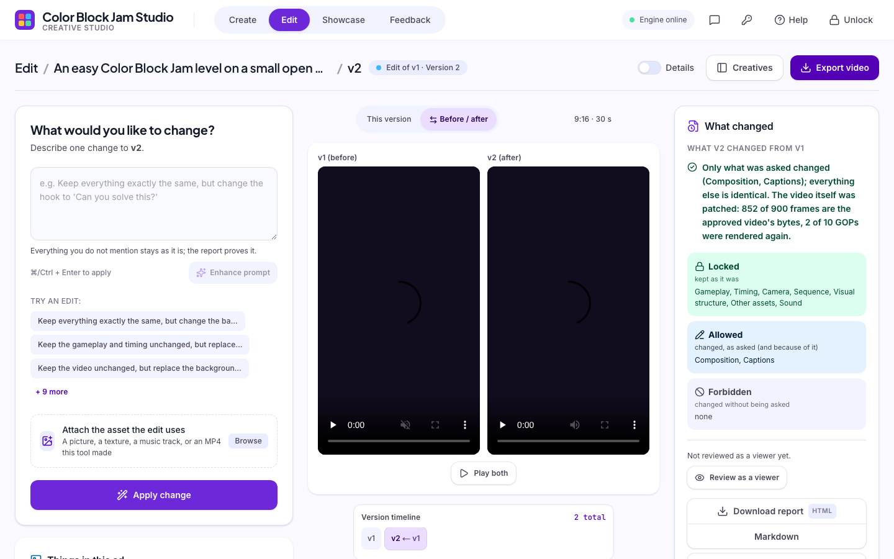
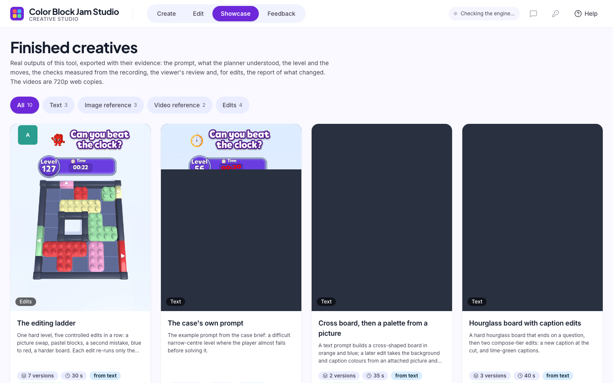
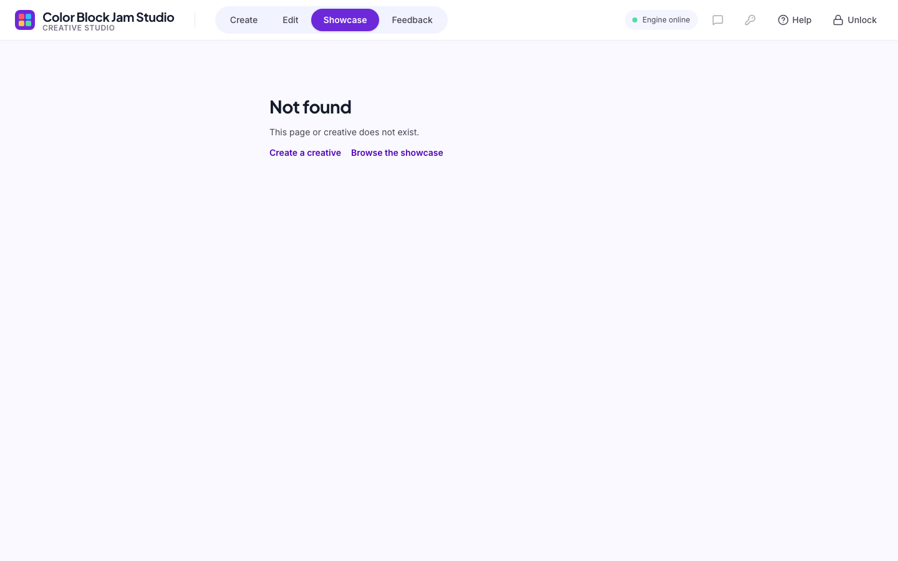

# How to use the web app

Site: **https://cbj-creative-studio.vercel.app** · Passcode for making and editing: **`geV0rjLVte`** (asked once per
browser; browsing the Showcase needs none). The header's pill says whether the engine is **online**; the engine is a
Mac running the Unity game, so when it is offline the Showcase still works and making waits.

## Create a creative from text

1. Type the request in plain words, English or Turkish. The eight things a prompt may control (page 3 of the brief):
   the type or structure of the level, the gameplay behaviour, difficulty or pacing, visual elements, the creative
   concept, the sequence of events, assets to use, elements that should stay unchanged. Examples that work well:
   - "Create a difficult CBJ level with a narrow center section and show gameplay where the player almost
     fails before solving it."
   - "An easy level on a small open board with four blocks in three colours. The player almost fails and solves it
     with two seconds left. The hook says 'Can you beat it?'. 30 seconds."
   - "Zor bir seviye, dar bir orta bölüm, oyuncu neredeyse kaybediyor ama son saniyede çözüyor, 45 saniye."
   The chips under the box ("Try an idea") fill a complete test prompt.
2. Optional helpers:
   - **Enhance prompt** rewrites the request in the words the planner reads best. It translates, replaces what the
     game cannot do with the closest legal thing and says so, removes claims ad rules forbid ("only 1% can solve this"),
     and offers up to three questions whose answers are sentences you tap. It never adds an ask by itself. **Undo**
     restores your text.
   - **Start from a trend (optional)**: prompts written from today's trending searches and news, or from a link you
     paste, each with its source and the reason it is current. **Use this prompt** puts one in the box.
   - **Creative specifications**: duration (30 / 45 / 60 s), format (9:16, 1:1, 16:9), difficulty, and the hook-and-
     ending arc. They add words to the prompt; the plan shows how they were read.
   - **Audio (optional)**: a music bed written from the creative's own concept, and the captions narrated. Added after
     the creative is made, as a music edit, so the silent original stays as version 1.
3. Press **Generate creative** (or **Plan only** to see the brief first, or **Level only** for the board and the moves
   in about 30 s without recording). Enter the passcode the first time.
4. While it runs: **What the tool understood** shows one row per prompt control with its status (applied, default,
   adjusted, not supported) and the assumptions; **Progress** shows plan, level, play, record, compose, review, revise.
   A creative takes a few minutes; the engine makes one at a time.
5. The result: the player with the ad; **Level & gameplay** with the board, the moves (key move, mistake, hesitation)
   and the **checks** measured from the game's own recording; **As a viewer** with the review (its measured scores are
   marked apart from the model's judgement), the fixes and one suggested edit you can apply with a click.
6. Under the result, **Was this what you asked?** sends feedback tied to the step it concerns; a flag on any row
   (a control, a check, a review line) pre-fills the step and the item. **Download report** gives every intermediate
   step as one HTML or Markdown file. **Edit this creative** opens the edit workspace.

## Create from a picture or a video

Drop the file on **Attachments** (PNG/JPG/WebP up to 15 MB; MP4/MOV/WebM up to 80 MB; WAV/MP3 for music). The badge
under the file says how it will be used, which depends on your words:

- A **reference picture**: "inspired by this image", "use this picture's look", "the board in this picture" → the
  picture's role is decided first (a style, a board to copy cell by cell, an asset to place, a change to an existing
  creative). The plan's **Reference to creative** card shows what was read, adapted and not copied.
- A **reference video**: any attached video is read whole for its structure, hook, ending, pace and captions; "same
  game design" / "this board" copies its board from the first frame of play; another game's mechanics are never used.
  "Create a CBJ version of this concept" adapts the concept.
- An **asset to place**: a picture without reference words ("put the attached logo in the corner", "use this object
  instead of the obstacle").

Sample files (the CBJ trailers, reference pictures, objects, textures, logos, stickers, a music track) are
listed in [TEST-ASSETS.md](TEST-ASSETS.md) and offered on the attachment zones when the catalogue is on.

## Edit a creative (controlled editing)

Open **Edit**, choose a creative (or press **Edit this creative** on a result). Two ways to change one thing:

- **Things in this ad**: every picture, caption, sound and music of this version with its time range. **Replace**,
  **Add**, **Edit text**, **Turn off**, **Remove** make the change in code, with no model and no prompt.
- **Describe one change**: "Keep everything exactly the same, but replace this asset" (attach the asset), "change the
  hook to 'Beat the clock!'", "make the blocks pastel", "put the attached picture behind the board", "a second mistake
  before the solve", "make it harder". **Enhance prompt** works here too, with this ad's inventory.

**Apply change** makes a new version; the old one is kept. The **What changed** card shows **Locked** (kept as it
was), **Allowed** (changed, as asked, and what changed because of it) and **Forbidden** (changed without being asked;
it must be empty). **Before / after** plays both versions side by side. **Details** opens the full nine-row checklist
(gameplay, timing, camera, composition, sequence, visual structure, other assets, captions, sound), the frames that
changed and the proof that every changed pixel sits inside the edited layers' boxes, **Compare** between any two
versions, the level and the moves, metadata and files. **More: music** makes a soundtrack for this version.

## Showcase

Finished creatives with their evidence, available with the engine off: filter by Text, Image reference, Video
reference, Edits. Each page shows the player, the prompt, what the tool understood, the reference card when a
reference was used, the level and its checks, the viewer's review, and for an edit the before/after pair and the full
report.

## Feedback (the owner's page)

**Feedback** in the header (passcode needed) lists every record with its step and item, **What the engine did** at
that step (facts and the engine's log lines), **Analyze what happened** (a verdict: the system, taste or unclear, with
quotes from the evidence only), and the **Lessons** tab: **Distill now** turns the records into a versioned document
with two tracks (what each workflow should do differently; how each designer asks), corrections in plain words, and
rollback. Nothing changes automatically.

## Your own account

The key icon opens **Your engine and keys**. **My own engine** runs the site on your own Claude Code login and Gemini
key, on your own machine, with no API key and no passcode (three steps are printed in the dialog; see the README).
The second mode takes a **Gemini key** alone, to read reference videos on your own quota.

## Command line (for those who run the engine)

`uv run cbj plan "..."`, `uv run cbj make`, `uv run cbj review <id>`, `uv run cbj report <id> --format html`,
`uv run cbj enhance "..."`, `uv run cbj trends`, `uv run cbj feedback`, `uv run cbj lessons --distill`,
`uv run cbj setup-check --live`; `uv run cbj --help` lists all 27 commands.
