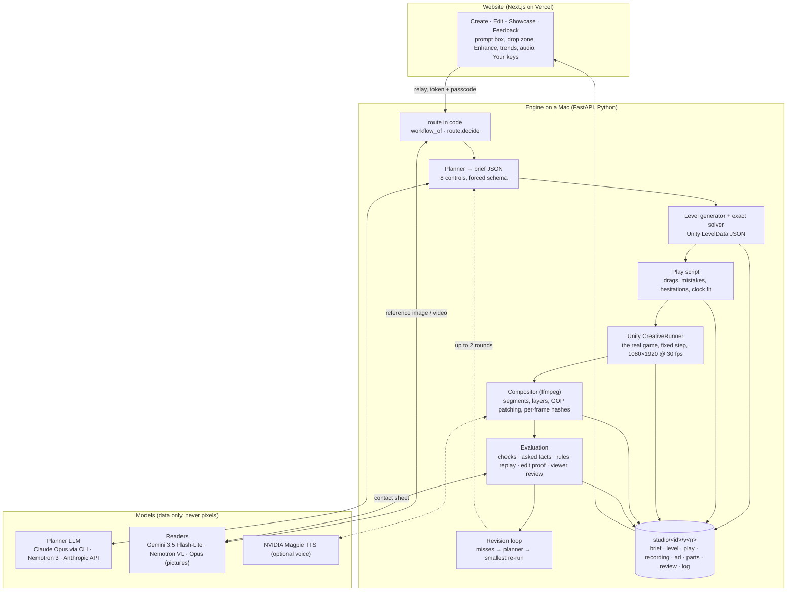
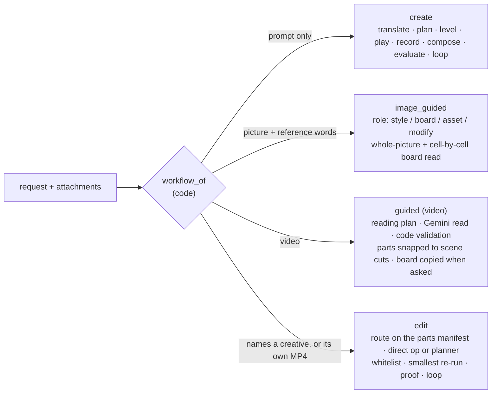
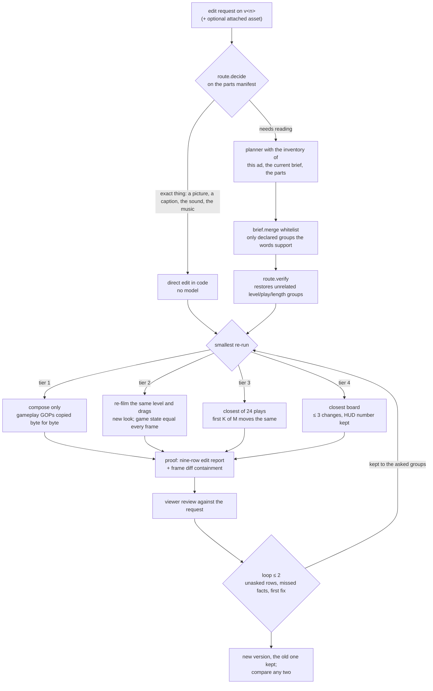

# Color Block Jam Creative Generation Tool: technical explanation

Prepared for the Rollic "AI Engineer, Creative" case. Every statement below was checked against the code in
`cbj-creative/`, the test logs and the working notes in `~/rollic-case/` at the time of writing. Numbers are from
the files named next to them; nothing was estimated.

**In one paragraph.** A tool was built in which a marketer types a request, optionally attaches a picture or a video,
and receives a 30-60 s Color Block Jam creative whose gameplay was played and recorded inside the provided Unity game.
A large language model is allowed to write only *data* (a typed brief, a reading of a reference, a review); every
pixel of gameplay is produced by the game itself from a level the solver proved solvable and a drag script the game
replayed one frame at a time. A follow-up request is treated as a patch to that data, not as a new generation, and a
nine-row report measured from the files proves what changed and what was kept. Four agentic workflows (text,
image-guided, video-guided, controlled edit) share one evaluation vocabulary and one feedback mechanism built on the
correction-record design of COLLEAGUE.SKILL, so the tool is corrected from what designers report, with evidence and
versions, and becomes more consistent with the team's intent over time.

| the delivered system, in numbers | |
|---|---|
| Python engine | 33,996 lines in 53 modules (`src/cbj`), 27 HTTP endpoints, 27 CLI commands |
| Unity side | `CreativeRunner.cs` (1,271 lines) plus a three-file game patch; the game's own services untouched |
| Tests | 1,481 passing, 28 skipped (full suite, `logs/pytest-common-1.log`) |
| Agent skills | 11, validated by `validate_skills.py --strict` |
| Website | Next.js on Vercel, 5 routes, 9 QA scripts; static showcase of 10 exported creatives |
| Creatives made during development | 542 folders under `studio/` |
| Test sets | 82 case scenarios, 48 edit prompts, 12 ending scenarios, 12 reading-accuracy clips, 10 image cases, 7 video cases, 5 edit cases |

---

## 1. How the problem was analysed before anything was built

### 1.1 The case document

The 14-page brief was read first and reduced to its grading rubric (p.11) and its deliverables (p.12). One idea was
found repeated on five pages: *consistency and controlled editing matter more than spectacle*. Page 8 says it plainly
(generative video drifts; use Unity for gameplay and AI around it) and page 13 prefers a focused, reliable tool to a
broad, flaky one. The eight prompt controls of page 3 (type or structure of the level, gameplay behaviour, difficulty
or pacing, visual elements, creative concept, sequence of events, assets to use, elements that should remain
unchanged) were adopted verbatim as the schema of the tool's brief, so that every request is read against the same
eight rows the case names (`brief.py:28-38`).

### 1.2 The game

The Unity project (Unity 6000.3.5f1, 3,784 lines of C#) was read script by script. The facts that shaped the design:

| fact in the C# | consequence for the tool |
|---|---|
| A level is plain JSON (`LevelData`: grid, inactive cells, blocks as polyominoes, exits with colour, edge and span) | A level is text: a generator can write it, a solver can verify it, the game loads it without a rebuild |
| Seven colours (`BlockColor`) | The colour vocabulary of every prompt and every check |
| `ExitService.CanBlockExit`: the first gate of the block's colour that the dragged block overlaps, a clear straight lane for every cell, checked only while dragging | Ported exactly to `rules.py`; the audit replays it on the recorded drags |
| Free 2D drag with continuous collision | Discretised to cell positions for the solver; the recorder drives the game's own movement service cell by cell |
| The clock starts on first touch, the win counts when the last slide ends | A near-fail is defined and measured as the clock reading when the last block leaves |
| No boosters, bombs, ice, keys, characters, items, second level | A closed list of what cannot be asked, written into the game-rules skill and answered as "not supported" |

### 1.3 The market

Before writing concepts, about 136 real video ads of Color Block Jam and its rivals (Block Out!, Pixel Flow!, Magic
Sort! and others) were downloaded from the Meta Ad Library and tagged frame by frame by how they end. Findings
that were used:

- Color Block Jam's own ads are real gameplay; the dominant ending across the market is *unresolved* (a cut mid-level).
- Only one rival shows an explicit fail; nobody runs a real near-fail win with the timer visible. This became the
  tool's default ending (`near_fail`) and its strongest concept.
- Channel evidence (AppsFlyer 2025; a field test of 9,993 viewers) shows the best ending depends on the channel, so
  the ending is a prompt control, never fixed.
- Ad rules (UK ASA rulings) require gameplay ads to show the real game and forbid odds, IQ and statistics claims. A
  copy guard in the compositor refuses such lines (`ad.py:64-76`), and the prompt enhancer replaces "only 1% can solve
  this" before planning.

### 1.4 The literature and the tools

A research pass checked about 35 papers and the candidate tools. Three results decided the architecture: LLM-written puzzle levels are solvable only 20-47% of the time
(ScriptDoctor, arXiv 2506.06524; Todd et al., 2302.05817); generative object replacement in video needs minutes per
5 s clip and still flickers or leaves shadows (VACE 2503.07598, BeyondMasks 2608.20107); purpose-built video judges
reach only 44-50% accuracy on absolute scores while pairwise and atomic yes/no questions do better (VideoScore2
2509.22799, ETVA 2503.16867, MLLM-as-a-Judge 2402.04788). The solver was therefore made the owner of the level, the
game the owner of the pixels, and the evaluation was built from measured yes/no rows with a model only for the soft
side.

### 1.5 From analysis to skills and restrictions

The findings were written down as portable Agent Skills before the workflows were coded, so that every agent that
touches a request (the enhancer, the planner, the editor, the auditor, and the coding agent that maintains the tool)
works from the same facts. Eleven skills exist today, each with a source-of-truth section, a procedure, a "not
possible here" list and change rules (`.claude/skills/README.md`):

| skill | what it fixes in place |
|---|---|
| `cbj-game-rules` | the game as implemented, line-cited; what does not exist in it |
| `cbj-prompt-controls` | the eight controls, their vocabulary, defaults and limits |
| `cbj-level-gameplay` | shapes, pieces, difficulty bands, endings, orders of interactions, the checks |
| `cbj-controlled-editing` | the edit whitelist, the smallest re-run, the nine-row report, refusals |
| `cbj-creative-review` | the viewer's rubric, what is measured and what is judged |
| `cbj-video-guided`, `cbj-image-guided` | what may be taken from a reference and what may not |
| `cbj-prompt-enhancement` | the enhancer's contract (nothing added) and the trend ideas |
| `cbj-feedback-lessons`, `cbj-soundtrack`, `cbj-creative-evidence` | feedback, audio, and where every fact of a version lives |

### 1.6 Why four workflows were built separately

The four core requirements were implemented as four separate agentic workflows (`workflows/create.py`,
`image_guided.py`, `guided.py`, `edit.py`), each with its own evaluation profile, so that each could be tested and
hardened on its own without regressions in the others (a rule kept throughout: a change to the video path could not
touch the text path, even through shared helpers). Once all four had been tested, they were compared and the lessons
that held for all were moved into shared helpers that each workflow imports (`workflows/__init__.py`, "Common to all four").
The intended next step is one orchestrator that routes to these four as tools, which the current routing in code
(`app.workflow_of`, `route.decide`) already prepares.

### 1.7 Order of work

1. The case analysed, the game's C# read, the plan written.
2. Research on papers, repositories and tools; Unity installed.
3. Level model, exact rules, exhaustive solver, the Unity CreativeRunner, competitor ad research.
4. Scenario scripts (endings, mistakes, pacing), compositor, text-to-creative, controlled editing.
5. 82 case scenarios run and the 13 failure groups fixed; ending test sets.
6. 48-prompt edit audit; evaluation coverage mapped to the case; the create/edit split; video-guided specification.
7. Image-guided workflow; the final editing approach; hard test sets.
8. Prompt enhancer and trend ideas; soundtrack and narration; designer feedback and the owner's lessons; website live.
9. Video boards copied cell by cell; door and colour rules on every workflow; edit set 2; feedback tied to steps,
   reports, own accounts; the cross-workflow pass; the demo recorded.

---

## 2. System architecture

Three facts about this picture:

1. **The website runs no workflow.** It is a client of the engine's HTTP API through a relay that adds the engine token
   and checks a passcode; a static showcase works with the engine off. The engine runs on a Mac because the Unity
   player and ffmpeg run there.
2. **Models write data.** The planner returns a brief against a forced JSON schema; the readers return a reading; the
   viewer returns a review. None of them emits a frame. The brief is then completed and bounded by code
   (`brief.check`, `brief.merge`).
3. **The creative is a document; the video is a view of it.** Each version folder holds the brief, the level, the play,
   the recording's own log, the ad description, the parts manifest, the review and the engine's log lines. Every later
   stage is a function of the files before it, which is what makes editing and proof possible.

### 2.1 Models in use, by role

| role | model actually used in the hosted tool | alternatives wired in |
|---|---|---|
| planner (prompt → brief), enhancer, trend ideas, lessons, feedback analysis | Claude Opus through the Claude Code CLI (`claude -p`, low effort, structured output), on the owner's account; another user's own CLI login on their own engine | NVIDIA Nemotron 3 Ultra / Super, open-weight models hosted on build.nvidia.com (strict JSON schema) |
| reference video reader | Gemini 3.5 Flash-Lite first (measured more accurate and 10× faster) | NVIDIA Nemotron 3.5 Super VL (open weights), then the Nemotron 3 Nano Omni 30B |
| reference picture reader | Opus via the CLI's Read tool when the planner is Claude | Gemini, then NVIDIA |
| viewer's review, likeness check | the vision client of the planner backend (Opus in practice) | NVIDIA vision models |
| spoken narration (optional) | NVIDIA Magpie TTS (English voices) | none |
| trend signals | Google Trends daily searches (no key) + Tavily news/extract | none |
| image, video or music **generation** | **none** in the delivered version: pictures are the user's uploads, gameplay is the game's, the music bed is synthesised in numpy | see §9 |

Measured reason for the reader order (12 of the tool's own creatives, same truth, `READING-ACCURACY-v8.md`): Gemini
read the ending, hook, call to action, captions and mechanics 12/12, structure 9/12 (40 of 45 part boundaries within
1 s), in 4-26 s per reading; the NVIDIA reader was 50-250 s with HTTP 500s and reasoning loops.

---

## 3. The main components of the pipeline

### 3.1 The brief: the request as a contract

The planner receives the system prompt, the game's facts and the request, and must return `brief.SCHEMA`: a summary,
one row per prompt control with a status (*applied / default / adjusted / not supported*), assumptions, and the
typed fields (`level`, `gameplay`, `pacing`, `visuals`, `concept`, `sequence`, `assets`, `audio`, `keep`,
`changed`). The rule of the system prompt is that a field is filled only from what the request says; everything else
stays at its default. `brief.check` then completes the brief and writes every adjustment into the matching control row
with the engine's reason, so the user sees "what the tool understood" as a table of the case's eight controls, not
as prose. Non-English requests are translated once, in a separate call, before routing, and the original is kept next
to the translation.

### 3.2 Level generation and the solver

- **Solver.** Breadth-first search over drags with an exit-first shortcut that was proved safe on 637 random boards,
  plus an A* variant (heuristic: blocks left) and an events solver over (position, events done) for requested orders
  of interactions. Both are exhaustive up to a state cap (2,000,000) and raise past it. The rules it searches are the
  C# rules ported line by line (`rules.py`).
- **Generator.** Random candidates for the requested shape (7 shapes), pieces (small, big, long), size, block count
  and colours, then solve, rate and local-search toward the requested difficulty band. Symmetric boards move mirror
  pairs; packed boards hold 55-75% of cells. Boards on which a simulated naive player gives up more than 5% of the
  time are rejected as unfair.
- **Difficulty.** Minimum drags, repositioning drags, blocks that can leave at once, first-drag options and the naive
  player's waste, from the solver; bands easy / balanced / hard are defined on these.
- **A miss is fixed at this stage when it can be.** If the audit finds the block count, the colours, a named block or
  the first blocked attempt missing, the studio generates again with other seeds and keeps the board with the fewest
  misses (`studio._level_gate`).

### 3.3 The play script

`play.py` turns the solution into human-looking play for the requested ending (*win, near-fail, cliffhanger,
time-out*): detours from the naive player as mistakes, hesitations and pauses on a pacing curve, a key move followed
by a cascade for a "satisfying finish", and the clock fitted so that a near-fail shows 00:01-00:03 as the last block
leaves. A dry run in the real game (no capture) validates the script before the recording.

### 3.4 The Unity CreativeRunner

A macOS player is built in batch mode from a copy of the provided project with one runtime script added and a
three-file game patch (the clock stops when the last block starts to leave; input is ignored after the fail screen).
The runner loads the level through the game's own `LevelManager`, disables the human input and camera controllers,
and re-implements the per-frame drag of `InputHandler` with a scripted finger through the game's own
`BlockMovementService`, `BlockGridService` and `ExitService`. Time is a fixed step (`Time.captureDeltaTime`); the
camera renders into a 1080×1920 texture; frames are read with `ReadPixels` and piped raw to ffmpeg (libx264,
CRF 16, MSAA 4). After every drag the runner checks the cells the block really entered against the script and writes
`result.json` (drags, gate numbers, first touch, win or fail, clock stop, block-gone frames, HUD rectangles) and
`frames.json` (timer, finger and block positions per frame). Repeat renders give the same game state exactly.

### 3.5 The compositor

`ad.py` describes the ad as segments (clip, hold, card) and layers (text, tag, image, button, cursor, vignette,
object on the walls, skin on a block) with times anchored to gameplay events (`beat.1.start`, `clock<=5`, `win`).
`compose.py` renders it with ffmpeg and writes `compose.json` with a SHA-256 of every frame. Every segment and layer
boundary starts a GOP, the encoder forces those keyframes and uses no B-frames, so an edit that keeps the order,
segments, sources, camera and cursor can copy the clean GOPs of the approved MP4 byte for byte and re-render only the
dirty ones (`compose.patch_plan`). Other formats (1:1, 4:5, 16:9) are derived from the 9:16 master. Sound effects are
synthesised in code; a copy guard refuses odds, IQ and statistics claims.

### 3.6 The evaluation

Three judgements are made on every version, in this order of trust:

| judgement | what it reads | made by |
|---|---|---|
| **Checks** (`checks.py`) | the recording's `result.json` and the level file: every planned drag moved the planned block through the planned cells to the planned outcome; the ending and the clock; mistakes; the order of interactions; the key move and the final run; difficulty numbers; block count and shapes; board shape and looks | code |
| **Asked-facts audit and rules replay** (`audit.py`) | the prompt itself (never the plan): block count, colours, named colours, shape, difficulty, length, seconds left, mistakes, the blocked attempt, the order, the finish, the ending, every quoted caption and its moment, walls, the clock, the HUD number, cursor, music, background, the sequence of parts, "gameplay at the centre" (under 40% fails); then the game's rules replayed on the drag log: one block per drag, legal moves, exits only through the first door of the block's own colour with a clear lane, the clock never below zero, the result consistent with the blocks gone, every colour with a door, colours at least 40 apart | code |
| **Viewer's review** (`review.py`) | a contact sheet (one frame per second, the second under each) with the prompt and the brief, judged as a person scrolling a feed with the sound off: match / partial / no per control, scores for pace, readability, clarity and call to action, would-download, three fixes and one edit prompt. Two scores are measured in code and passed as final (the second the game first moves, the share of held screen) | a vision model |

Each row says which stage missed (plan, level, play or ad). A row "facts read from the prompt" lists what the parsers
recognised, so an unrecognised phrasing is visible rather than silently passed.

### 3.7 The revision loop

After the make, the measured misses and the viewer's first fix become one feedback text; the planner replans it as an
edit of the made version; the smallest re-run is made and reviewed again. At most two rounds. The loop keeps the
version with the fewest misses rather than the last, keeps every value the request states, never plans a longer play
for a take that ran over, makes no version for a viewer-only remark that changes nothing the viewer pointed at, and
stops when the same row misses twice with the same measure (the board's limit, said in the record).

### 3.8 The four workflows

- **Text.** As in §3.1-3.7. Twelve ending scenarios (three puzzles × four endings) and the 24 text scenarios of the
  82-scenario set were its hardening sets.
- **Image-guided.** The picture's role is decided first (style, board, asset to place, or a modification of an existing
  creative; a picture can have two roles). Code measures the palette, margins, caption colours and board symmetry;
  the model reads the picture whole and the board cell by cell (corners, perspective warp, cells, pixel verification);
  the board is solved and saved as a level with source "picture". Colours map to the seven game slots by hue family
  so that the game's own renderer can draw the picture's board. In the image test set, 8 of 10 reference boards were
  copied cell for cell; the other two were built as the picture's type and said so.
- **Video-guided.** The clip is reduced to one small copy of at most ~200 frames; a reading plan is written for the
  request; the clip is read whole (Gemini first), the ending re-read on the last seconds, the parts snapped to ffmpeg
  scene cuts, and the answer validated in code with one re-ask. What may be taken depends on the focus: concept, hook,
  pacing, captions, ending, look, structure (length, replay, hold, end card) and the board's type; another game's
  mechanics are never used. When the words ask for *the* video's board ("same game design", "this board", "take the
  board from this video"), the first frame of play is read cell by cell and the board is copied, with changes applied
  on it (fewer or more blocks, mirrored, one colour fewer). In the video test set, all seven cases ended with a copied
  board, including a Turkish request and a board taken from another publisher's ad.
- **Edit.** §7.

### 3.9 Around the workflows: what else was built

These parts sit in front of or beside the workflows and never change what a workflow does with a prompt.

| part | what it does | where |
|---|---|---|
| **Prompt enhancer** | rewrites a request in the words the planner reads reliably (translated, clarified, impossible asks replaced by the closest legal thing and said so), **adds nothing**, and offers up to three questions whose options are sentences the user taps; code checks every rewrite (facts kept, no technical names, captions ≤ 6 words, no statistics); one-click undo | `enhance.py`, the *Enhance prompt* button on Create and Edit |
| **Ideas from trends** | Google Trends daily searches plus Tavily news, or one pasted link, turned into 2-4 complete prompts in the house style with source, "why now" and the mapping to the game's levers; unsafe or brand-bound trends skipped with reasons; cached 6 h | `trends.py`, the *Start from a trend* card |
| **Soundtrack and narration** | a music bed synthesised in numpy from the version's own facts (theme → scale, tempo and curve → bpm, a pluck at each block exit, a riser and ticks for a near-fail, a held chord for a cliffhanger); optionally the creative's own captions narrated by NVIDIA Magpie as they appear; delivered as an upload and applied through the ordinary music edit, so it comes with the edit report | `soundtrack.py`, the *Audio (optional)* row and the *Soundtrack* card |
| **Designer feedback** | under every result: *Was this what you asked?* with a step chip (how the request was read, the level, the gameplay, the video, the review, the revision, the edit report), an item, and flags on individual rows that pre-fill both; the scene is captured by the engine from the stored version, never trusted from the browser | `feedback.py`, `FeedbackPanel.tsx` |
| **Owner's analysis and lessons** | on the owner's page, each record shows what the engine did at that step (facts and log lines) and *Analyze what happened* asks the model for what / why / verdict (the system, taste, unclear) with only quotes that exist in the evidence; *Distill* turns the records into a versioned LESSONS document with two tracks (what each workflow should do differently; how each designer asks), evidence ids, corrections in plain words and rollback | `feedback.analyze`, `lessons.py`, `/feedback` |
| **Report** | a downloadable Markdown or HTML report of any version: the request, how it was read, the steps and their seconds, the level and the play, the checks, the edit report, the review, the revision, the feedback left, the files | `report.py`, *Download report* |
| **Own accounts** | the tool runs on the owner's Claude login (the Claude Code CLI) and Gemini key by default; another user runs the engine on their own machine with their own Claude CLI login and their own Gemini key, with no API key (`cbj setup-check --live` proves the setup), and can point the hosted site at that engine (*Your engine*: URL, optional token, a Check button; every call and every video then goes to their machine); a Gemini key alone can also be sent per request to the studio's engine for reading reference videos on the user's own quota, in a header that is never stored or served | `setup_check.py`, `keys.py`, `KeysDialog.tsx` |

### 3.10 The research integrated for adaptability: COLLEAGUE.SKILL

**The paper.** COLLEAGUE.SKILL (Zhou, Liu, Yuan, Shao, Hu; Shanghai AI Laboratory; arXiv 2605.31264) proposes
*person-grounded skill distillation*: heterogeneous traces of a person or a role (chat logs, documents, reviews,
incident notes) are distilled into a versioned package an agent can load, with two tracks kept apart: a **capability
track** (procedures, standards, decision heuristics) and a bounded **behaviour track** (communication style,
interaction rules, a correction log). The package is portable, inspectable, composable, correctable and governable.
A correction arrives in natural language and becomes either a patch to a section or a normalised record
`{scene, wrong, correct}`; every correction increments the version, archives the previous one and can be rolled back.
The paper claims the artefact format and its lifecycle, not behavioural fidelity.

**Why it was judged to fit this case.** The tool is used by several designers and its workflows are prompt-as-contract
code and skills that the owner tunes by hand. What the owner needs from a designer is exactly the paper's correction
record: which creative, which version, which step, what was wrong, what was expected. What the owner needs from a pile
of such records is the paper's two tracks: *what the system should do differently* kept apart from *how each person
asks*, because a complaint can be a system fault or one designer's taste and the two call for different changes.

**How it was mapped onto the tool.**

| paper element | implementation in the tool |
|---|---|
| correction record `{scene, wrong, correct}` | a feedback record: the scene captured by the engine from the stored version (workflow, prompt, version, the step and the item, the engine's facts and log lines at that step), what happened, what was expected; appended to an immutable log |
| heterogeneous traces | records from the result page, the edit workspace, the showcase and the header; flags on individual rows (a control, a check, a review line, an edit-report row) |
| capability track | LESSONS Part A, per workflow: the lesson, the evidence ids, the suggested change, a confidence that code demotes to *thin* unless at least three records from two designers back it |
| behaviour track | LESSONS Part B, per designer: habitual asks and phrasing, from that designer's records only; never placed in any prompt |
| correction in natural language | *Correct a lesson in your words*: appended to a corrections log, outranks the records, produces a new version |
| versions, archive, rollback | `studio/_lessons/v<N>/` with `current.json`; rollback moves the pointer; nothing is deleted; lessons that cite no existing record are dropped and listed |
| the loadable package | the eleven skills next to the code, each with a last-verified stamp and change rules: an accepted lesson becomes a line in a skill, a planner rule or a measured row |
| provenance of a change | the analysis per record (what, why, the system or taste) quotes only text that exists in the evidence |

**Why it matters for performance and consistency.** First, a complaint is classified as the system or taste before
anything changes, so a workflow is not bent to one person's habit. Second, every change to a rule, a skill section or a
measured row carries evidence ids and a version, so a regression can be traced and rolled back. Third, the same package
is read by every agent in the chain (the enhancer, the planner, the editor, the auditor and the coding agent), so a
lesson learnt once applies to all four workflows; the cross-workflow pass, in which lessons learnt on the reference
workflows were moved into shared helpers, was this mechanism done by hand. Fourth, with more colleagues the distilled
package becomes the shared, inspectable memory of how the team wants creatives made.

**What was left out, and why.** Simulating a designer, automatic pre-filling of a designer's habitual asks (it would
break the prompt-as-contract design), installing the package into an agent host, galleries and distribution. Nothing
is applied automatically: no workflow, planner or enhancer imports the feedback or lessons modules (a test checks the
import lines of every source file), and the owner verifies against the evidence before changing code or a skill.

**First run.** Four records on one creative from two designers were distilled into a first version in 16.5 s: a strong
lesson backed by two designers, three thin ones labelled as such, a per-designer entry with that designer's own
record ids, and an open question where the model noticed that a phrase was not in the recorded prompt rather than
inventing a fact.

---

## 4. Why this approach was chosen

1. **The case's own evidence pointed at it.** Page 8 names the failure modes of pure generative video (objects change,
   rules break, layouts drift, edits are hard to control) and offers Unity as the fix. The competitor research found
   Color Block Jam's own ads to be real gameplay, and the ad rulings require it.
2. **Published results ruled out the alternatives.** LLM-written puzzle levels are solvable 20-47% of the time;
   generative object replacement costs minutes per clip and leaves artefacts; absolute video judges are near chance.
   So the solver owns solvability, the game owns the pixels, and the judge is a set of measured yes/no rows with a
   model only for taste.
3. **A typed brief makes every control measurable.** Because the planner may only fill the case's eight controls, the
   audit can read the prompt independently and check each fact against the recording. A plan that quietly dropped
   something is caught, and the user sees the eight rows, not a paragraph.
4. **A document, not a video, is what gets edited.** Keeping every stage as a file makes "change only this" a change
   to one field followed by the smallest re-run, with proof from the files (§7). This is the property the case weights
   most, and it cannot be retrofitted onto a generated MP4.
5. **Separate workflows first, one orchestrator later.** Each requirement was hardened in isolation on its own test
   set, with its own evaluation profile; what proved common was then shared. This gave measurable progress per
   requirement in ten days and leaves a clean path to a single agent that calls the four as tools.
6. **Feedback makes the workflows adaptable.** A designer's note is tied to the step it is about and to the engine's
   own record of that step; the owner's analysis says whether it was the system or taste; the lessons document
   accumulates such corrections with versions and rollback. The intended effect, following the correction-record idea
   of COLLEAGUE.SKILL (arXiv 2605.31264, §4.2), is that the workflows, their prompts and their skills are tuned from
   evidence over time, so creatives become more consistent with what the team wants rather than with what one prompt
   happened to say. Nothing is changed automatically today: the owner reads, verifies and edits code or a skill.

---

## 5. Which parts are deterministic and which use generative AI

| stage | deterministic (code) | generative (a model) | what the model may produce |
|---|---|---|---|
| routing | `workflow_of`, `route.decide` on words, attachments and the parts manifest | – | – |
| translation | the English word tables that follow | one call when the request is not English | an English rewrite; the original kept |
| prompt enhancement | fact guards, caption and policy checks, undo | the rewrite and the questions | text, nothing added |
| planning | `brief.check`, `brief.merge` whitelist, defaults, engine notes | the planner | the brief JSON against a forced schema |
| reference reading | palette, margins, scene cuts, cell geometry, pixel verification, code validation and re-ask | the picture or clip read | a reading JSON, validated in code |
| level | generator, exact solver, difficulty rating, local search, regeneration on a miss | – | – |
| play | scenario script, dry run in the game | – | – |
| recording | the Unity game at a fixed step | – | – |
| compositing | segments, layers, GOP patching, hashes, format derivation, sound effects | – | – |
| soundtrack | the synthesised bed | the optional voice (TTS) | spoken captions only |
| checks, audit, rules, edit proof | all rows measured from the files | – | – |
| review | first-move second, held-screen share, caption reading times | the viewer | a review JSON and one edit prompt |
| revision | the smallest re-run, best-version rule, stop rules | the planner replans the feedback | a patched brief |
| feedback and lessons | scene capture, evidence, backing of quotes, version lifecycle | analysis and distillation | text with evidence ids, never applied automatically |

The invariant that was kept throughout: **a generative part writes data and never draws a gameplay pixel.**

---

## 6. How consistency between generations is maintained

- **One engine, one rule set.** Every gameplay frame comes from the same built player running the provided game's
  services; the solver and the audit use the same rules ported from the C#. A block can never move or exit in a way
  the game would not allow, in any version of any creative.
- **Repeatability by construction.** Fixed time step, fixed particle seeds, instant button fades, a scripted finger;
  the recorder verifies the cells entered against the script; repeat renders are identical in game state and
  near-identical in pixels. Recordings are cached by the hash of their job, so the same level and drags are never
  filmed twice.
- **The brief as the single source.** Every version carries the brief that produced it; defaults are explicit;
  anything the planner did not fill is the same default for every creative. The merge whitelist means a later prompt
  cannot change a field the words do not support.
- **Shared vocabulary across workflows.** The eight controls, the seven colours, the four endings, the length range
  and the case rows are the same in all four workflows; the rules rows, the door and colour rows and the shared case
  rows run on every version regardless of the path that made it.
- **Measured colours and looks.** Colours are checked to be at least 40 apart with distinct names on every board; a
  reference's colours map to the game's slots by hue family; a repaint that would make two gates look alike is
  deepened or reverted and said.
- **The loop converges, it does not wander.** Best version kept, stated values protected, a take that overran never
  lengthened, a repeated identical miss stops the loop. The first version is never lost.
- **Reproducibility of evidence.** Each version folder holds the files needed to replay it, the log lines of the
  engine, the review sheet and the proof; the report and the evidence skill describe how any claim is re-checked.

---

## 7. How controlled editing works

### 7.1 The idea

The creative is a document; the video is a view of it. An edit is a change to the document, routed in code before
any model reads it, bounded by a whitelist, executed by the smallest re-run that can honour it, and proven from the
stored files rather than from the plan.

### 7.2 The edit contract

- **Locked**: everything the request did not name (the level, the drags, the camera, the ad's parts and their timing,
  every other layer, the sound).
- **Allowed**: the named element, in its own box and time window.
- **Forbidden**: any other difference. One fails the edit and is sent to the loop.

The whitelist is the guarantee: the planner declares the field groups it changed, and `brief.merge` takes a group
only when it was declared **and** the request's words support that change; "prone" groups (copy, sizes, colours, the
level number, events, length) need both. `route.verify` restores any level, play or length group the planner touched
on a route that is not a gameplay edit.

### 7.3 Direct edits (no model)

A picture slot (logo, second logo, hook icon, end art, button, end background, cursor, the walls' object, a block's
skin), a caption's text, the sound on or off, the music. The website's *Things in this ad* lists them with their time
ranges, so a designer replaces, rewrites or removes one with no prompt at all. A colour word in a request ("the cyan
block") is resolved to a game slot through the shown colour names, the repaint and the nearest shade.

### 7.4 Four tiers of preservation, lowest sufficient tier wins

| tier | used for | what re-runs | proof |
|---|---|---|---|
| 1 compose | captions, pictures, sound, music | the compositor only | the recording's frames reused; the changed-pixel box inside the edited layer's box; clean GOPs of the approved MP4 copied byte for byte |
| 2 re-film | colours, background, camera, HUD, the clock, the level number | the same level and drags filmed again | the game's log: state identical on every frame; the ad's timing pinned |
| 3 re-plan | a second mistake, another order, pacing that needs new moves | the closest of 24 plays (20 s budget) | "the first K of M moves are the same, N in common" |
| 4 re-generate | harder, easier, a different board | the closest board (at most 3 changes), the HUD number kept | the two boards side by side, the changes listed |

### 7.5 The evidence report

Nine rows, the case's seven preservation items plus captions and sound: **Gameplay, Timing, Camera, Composition,
Sequence, Visual structure, Other assets, Captions, Sound**. Each is measured from the stored files and marked *kept /
changed as asked / changed because of the asked change (reason written) / changed without being asked (fails)*. Then
the pixels: frames changed and their ranges, the changed-pixel box, and whether every changed pixel lies inside the
changed layers' boxes; a leak is named. A result identical in every row is refused as a no-op. The website shows the
same report as three boxes (Locked, Allowed, Forbidden) for the designer, with the full checklist, the before/after
player pair and *Compare any two versions* behind a Details switch.

### 7.6 What is refused, and said

A recolour that makes two gates look alike; a no-op edit; an edit of a video the tool did not make (routed to "adapt
the concept" with a plain message, since the document is not available); a block-shape change dressed as a visual
edit (a shape is gameplay: tier 4, and the report says so).

### 7.7 Results of the second edit set (on video-guided creatives)

| case | request | route | re-run | what the proof measured |
|---|---|---|---|---|
| E1 | "replace this object with the attached dice" (end card) | planner, pointer resolved to the end art | compose | 1,336 of 1,440 frames reused byte for byte; pixels inside the end-art box |
| E2 | a boulder picture on the trailer's wall cells | direct (object slot) | compose | drawn on every board part and on the end card's thumbnail; nothing else changed |
| E3 | a pointer cursor instead of the hand | direct (cursor slot) | compose | the cursor spans the whole play, so the GOPs were re-rendered; pixels inside the cursor track |
| E4 | an ice texture on "the cyan block" | planner, colour word resolved to the slot | compose | one block of that colour skinned; level, drags, captions, length kept |
| E5 | an autumn picture behind the board | planner | re-film | game state identical on every frame; same drags, same clock |

All five held every invariant (level hash, drags, recording reused or re-filmed identically, no row changed without
being asked, pixels contained, captions, colours and length kept) and needed no revision round.

---

## 8. Evidence that the system works

| set | what was measured | result |
|---|---|---|
| 82 case scenarios (all five requirements + UI) | the harness's verdicts, corrected by hand | at that stage R1 18/24, R2 15/17, R3 11/15, R4 0/3 (videos not yet accepted), R5 19/23; the 13 failure groups were fixed and the sets re-run |
| 48-prompt edit audit | edit routing and the report on designers' phrasings | the routing on the parts manifest and the three analysis levels came out of it |
| 12 ending scenarios | three puzzles × four endings, loop on | the real misses were in time-outs; causes fixed |
| reading accuracy, 12 creatives | the video reader against the known truth | ending, hook, CTA, captions, mechanics 12/12; structure 9/12 |
| image-guided S1-S10 | board copied cell for cell, colours, likeness, coverage | 8/10 copied; every ask has a measured row |
| video-guided V0-V6 | board copied, mirrored, fewer blocks, colours, ending, length | 7/7 copied; remaining misses were stated in the plan (a 16-block board cannot fit 45 s) |
| edit set E1-E5 | the nine rows, the pixel box, the recording reuse | 5/5 held every invariant |
| unit suite | solver, rules, brief, route, compositor, audit, workflows, app | 1,481 passed, 28 skipped |

---

## 9. The main limitations of the current version

- **Time.** The planner takes 15-45 s per call; the Unity recording runs at about twice real time; the compositor
  adds 20-40 s; a reference video reading adds 4-26 s (Gemini) or far more on the fallback; the review and up to two
  revision rounds repeat part of this. A creative with the loop on takes several minutes, and the engine makes one at a
  time because there is one game player process on one Mac.
- **Video analysis will be costly at volume.** Every reference clip is re-encoded and read whole by a hosted model,
  the ending is read a second time, and a copied board needs a further cell reading. On the free Gemini tier quotas
  and "high demand" errors were met and absorbed by back-off; at a team's volume this becomes a paid line item, and
  the content terms of free tiers do not suit client material.
- **One level per ad; the game owns the look.** Textures and objects are composited from the recorded positions
  rather than rendered in-game (the game's lighting is not on them); a 3D asset cannot replace a block piece yet; the
  walls' picture is a compositor layer.
- **Reference limits.** A video's board is read from one frame; a board that changes before the first drag, or a hand
  over it, reads worse. A copied board has the play it has: a long solution overruns a short stated length and a small
  board leaves a long end card; both are said at plan time, not silently fixed. The live game's palette has colours the
  build lacks; two reference blues cannot both be blue.
- **Language.** The parsers that measure facts are English word tables; a request is translated once, and the
  translation is not stable word for word, so the plain forms of every phrase have to be covered. The narration voice
  is English only.
- **Judgement, and one model family doing two jobs.** The viewer's review and the likeness verdict are a model's
  opinion of a contact sheet; they are shown as such and never override a measured row. Today the same model family
  plans the brief and reviews the result. Models are known to recognise and prefer their own outputs (self-preference
  bias, Panickssery et al. 2024, arXiv 2404.13076), so the review is a weaker check on the plan than an independent
  judge would be. The measured rows do not have this problem, which is one more reason they are the backbone.
- **Not built.** The difference heatmap strip for edits (numbers and the before/after pair exist, no picture of the
  difference); in-game textures; reconstruction of an external Color Block Jam creative into the document; accounts
  (designer names are self-declared); automatic use of the lessons.
- **The engine is a single Mac.** The website is static without it; a tunnel exposes it.

---

## 10. What would be improved in a production system

### 10.1 More models, and open-weight ones where they lower cost and raise consistency

The delivered version plans with a hosted Claude model, reads references with a hosted Gemini model, and uses no
generative media model at all. In production each role would have a primary and a fallback, with open-weight models
self-hosted for the high-volume roles. Two groups are listed: the open-weight models already wired into the tool,
which today run hosted on build.nvidia.com and can be self-hosted as they are, and the current generation of
candidates for the other roles. Licences and capabilities were read on the official model cards at the time of
writing; the licence text would be re-read and every swap measured on the benchmark of §10.3 before adoption.

**Already in the tool (NVIDIA path), open weights**

| role in this tool | model | licence (as published) | notes |
|---|---|---|---|
| planner fallback (strict JSON schema) | Nemotron 3 Ultra 550B-A55B | OpenMDW-1.1 | tool calling and structured-output training; 1M context; the brief schema works unchanged |
| cheaper planner fallback | Nemotron 3 Super 120B-A12B | NVIDIA Nemotron Open Model License | 12B active parameters |
| video and picture reader fallback | Nemotron 3.5 Super VL 120B-A12B | OpenMDW-1.1 | the newest of the family; MP4 input up to 2 min, up to 256 frames at 2 fps, which matches the ≤200-frame copy the tool reads |
| omni reader fallback | Nemotron 3 Nano Omni 30B-A3B | hosted today; weight licence to confirm | image and video reading with reasoning |
| spoken narration | Magpie TTS multilingual | NVIDIA Open Model licence (to confirm) | English voices in use; no Turkish voice |

**Candidates for the other roles, current generation**

| role in this tool | candidate | licence (as published) | why it fits |
|---|---|---|---|
| planner, enhancer, lessons, feedback analysis (a different family from the judge) | GLM-5.2 (753B, 1M context); DeepSeek-V4-Flash (284B, 13B active, 1M context); gpt-oss-120b (117B, 5.1B active) | MIT; MIT; Apache-2.0 | long context for the planner's inventory and the lessons distillation; gpt-oss has native structured outputs, the others tool-use benchmarks |
| reference picture and video reader; viewer's judge | Qwen3.8-27B (native image and video, hour-scale); Qwen3.6-35B-A3B (3B active; Video-MME 82.5, MVBench 74.6, LVBench 71.4; tool calling) | Apache-2.0; Apache-2.0 | a dense 27B or a 3B-active model can read every reference and judge every version locally, which removes the per-clip cost and the free-tier limits of §9 |
| second judge of another model family (pairwise with the first) | GLM-5.3-Flash (320B, 18B active, natively multimodal); Kimi K2.5 (1T, 32B active, image and video input) | MIT; Modified MIT | an independent opinion for the likeness and the review, where a single model's verdict is the current limit |
| assets for the compositor's picture slots (logo, end art, stickers, textures), today the user's uploads | Qwen-Image-Edit-2509 (multi-image editing, legible text); FLUX.2 [klein] 4B (generation and multi-reference editing); Qwen-Image-2512 (text-to-image) | Apache-2.0 each | a brand asset restyled rather than regenerated; the newest Qwen-Image-2.1 is stronger but under a non-commercial research licence and so excluded |
| optional hook and outro clips (never gameplay), from the game's own first or last frame | Wan2.2 (TI2V-5B, I2V-A14B; the newest open-weight Wan); LTX-2.5 (image-to-video with audio) | Apache-2.0; LTX community licence, revenue-gated, to confirm | image-to-video at 720p from a given frame, matched to the recording's first frame as the plan intended |
| music bed, today a synthesised jingle | ACE-Step 1.5 | Apache-2.0 | about 2 s of compute per minute of audio on an A100; an 8 GB VRAM mode; the bed would follow the same facts (tempo, exits, ending) as cues |
| narration, today English only | Chatterbox multilingual (23 languages, Turkish included; zero-shot voices) | MIT | Turkish captions could be narrated in a consistent brand voice; Qwen3-TTS (Apache-2.0) was checked and lacks Turkish |

Closed models would stay where they measured best (Gemini for long clips; Claude for planning) and would be swapped
only when the benchmark says so. Open weights serve the two aims named in the case: lower cost per creative at a
team's volume, and consistency, because a pinned local model does not change under the tool between two generations
the way a hosted endpoint can.

### 10.2 A better evaluation: different models for different tasks, open and closed judges together

The measured rows stay the backbone. The first change is the separation of roles by model family: the model that
plans a brief, the model that reads a reference and the model that judges the result should not be the same, because
models recognise and favour their own outputs (self-preference bias, Panickssery et al. 2024) and share blind spots
within a family. In the delivered version one family does most of these jobs, which was a matter of time, not design.
In production: one family plans, a second reads references, a third judges, and each role has a fallback of yet
another family, chosen per task on the benchmark of §10.3 rather than by preference. On top of that: two judges of
different families (one open, one closed) asked atomic yes/no questions with key-frame evidence rather than absolute
scores, pairwise comparison between versions instead of a lone grade, and agreement tracked against the owner's and
the designers' verdicts from the feedback store. VBench / VBench-2.0 (Apache-2.0) would be used for the generative hook and outro clips only, since gameplay
frames are already proven by the game. The feedback analysis already classifies a complaint as system or taste; that
label becomes a training signal for which judge to trust on which row.

### 10.3 A benchmark, so that every change is measurable

The dated test sets already exist: 82 case scenarios, 48 edit prompts, 12 ending scenarios, 10 image cases, 7 video
cases, 5 edit cases, 12 reading-accuracy clips. They would be frozen as a benchmark with the truth per case (the asked
facts, the expected board, the expected rows), run by the existing harnesses, and summarised in one scorecard per
configuration: misses per row, boards copied, reading accuracy per field, proof containment, revision rounds, seconds
and cost per creative. A model swap, a prompt change, a new skill section or a new rule row is then a line in that
table, and a regression blocks the change. Over time the designers' feedback records add cases the authors did not
think of, which is how the benchmark grows with the team.

### 10.4 Better feedback, more adaptive workflows

The COLLEAGUE.SKILL integration of §3.10 is in place in its bounded form: records tied to steps, evidence from the
engine, a per-record analysis, and a versioned two-track lessons document with corrections and rollback. The
production steps follow the paper's lifecycle one step further while keeping the owner in the loop:

1. **Lessons that propose patches.** A lesson would carry a concrete diff to a skill section, a planner rule or a
   measured row, with its evidence ids, for the owner to accept or reject; an accepted patch bumps the skill's version
   and is traceable to the records that caused it.
2. **The benchmark closes the loop.** Every accepted patch is run on the benchmark of §10.3 before it ships, and the
   analysis verdicts (the system or taste) become labels for which judge to trust on which row.
3. **Behaviour track used safely.** Per-designer phrasing stays out of prompts, but it can seed the enhancer's
   questions for that designer, which keeps the prompt-as-contract design intact.
4. **Shared memory for more colleagues.** With more designers and more owners the same package is the inspectable,
   rollable record of how the team wants creatives made, rather than a set of habits in one person's head; new
   colleagues load it, and the agents already read it.

### 10.5 Engineering

One orchestrator over the four workflows as tools, with the routing that exists today as its first step; a job queue
with several Unity players (Linux batch builds) so that creatives are made in parallel; in-game textures on the slot
materials and a user 3D object as a block piece (the mechanisms were identified in the game's `BlockPieceConfig`);
the walls as in-game quads; the difference heatmap strip in the report; reconstruction of an external Color Block Jam
creative into the document (grid from the board's box, per-cell colour classifier, drags from rest-state differences,
each candidate validated by the solver); accounts and roles on the site; a paid, regional model endpoint for client
material.

---

## Appendix A. Where things are

| | |
|---|---|
| engine | `cbj-creative/src/cbj/` (workflows in `workflows/`), `cbj-creative/unity/CreativeRunner/`, `cbj-creative/tests/` |
| website | `cbj-creative/web/` (Next.js), live at https://cbj-creative-studio.vercel.app (passcode-gated for making and editing) |
| skills | `cbj-creative/.claude/skills/` |
| stored creatives and evidence | `cbj-creative/studio/<id>/v<n>/` |
| working notes and test sets | `~/rollic-case/*.md` and the `req3-image-guided-*`, `req4-video-refs-*`, `req5-edits-*`, `case-test-*` folders |
| setup | `README.md` ("Setup", "Run it on your own accounts"); `uv run cbj setup-check --live` |

## Appendix B. Papers referred to

ScriptDoctor 2506.06524; Todd et al. 2302.05817; Enigmata 2505.19914; Jarušek & Pelánek (FLAIRS 2011); Taylor &
Parberry (2011); Larche et al. 2017; Moon et al. 2026; VACE 2503.07598; BeyondMasks 2608.20107; ETVA 2503.16867;
MLLM-as-a-Judge 2402.04788; VideoScore2 2509.22799; VideoAds 2504.09282; Decoding the Hook 2602.22299; COLLEAGUE.SKILL
2605.31264; VBench 2311.17982 and VBench-2.0 2503.21755; Panickssery, Bowman & Feng 2024, "LLM Evaluators Recognize
and Favor Their Own Generations", 2404.13076.
